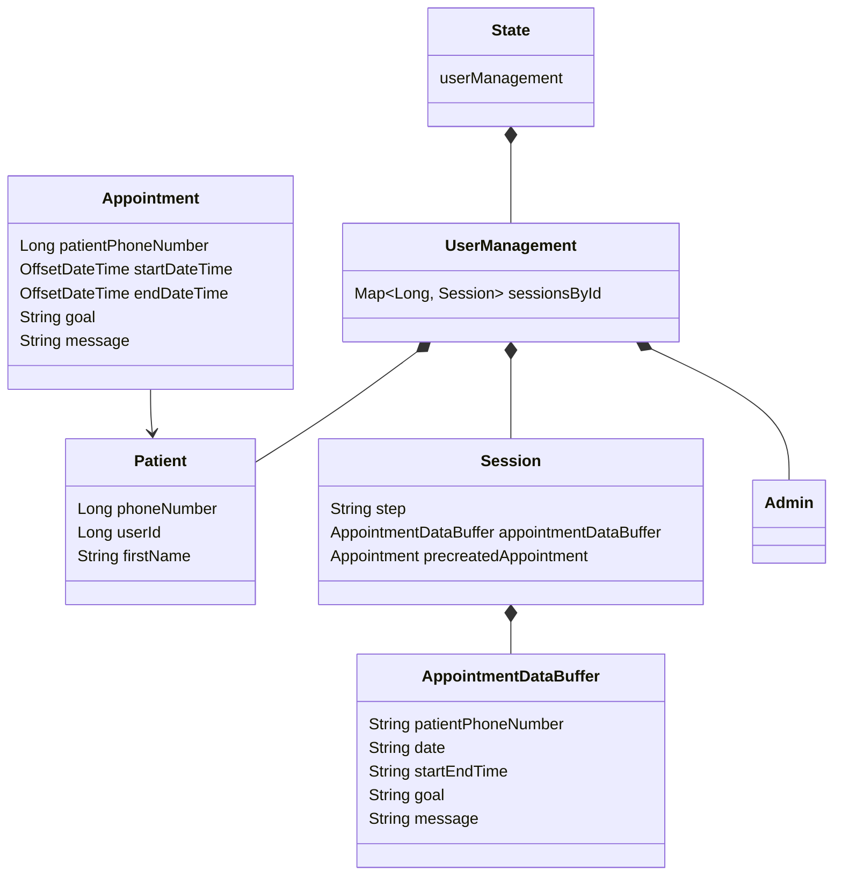
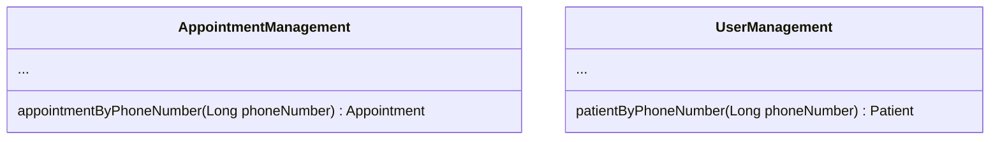

# System Overview

Code structure follows
the [Data-Oriented Programming](https://clojureverse.org/t/review-what-is-data-oriented-programming/6065) paradigm.

## Modules

* bot - frontend for MAX users
* core - backend

## Data Entities

* `Session` is used in the process of Appointment creation / editing.

## Code Modules
Business logic written in `AppointmentManagement` and `UserManagement` modules.

# Multitenancy
The bot is assumed to be used in a single tenant environment. So, the state is stored in a mutable map.